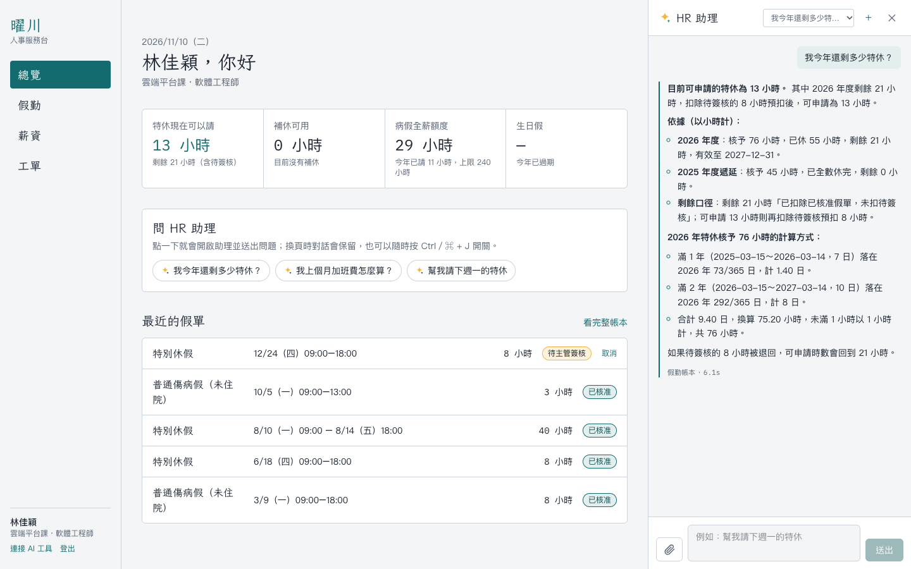
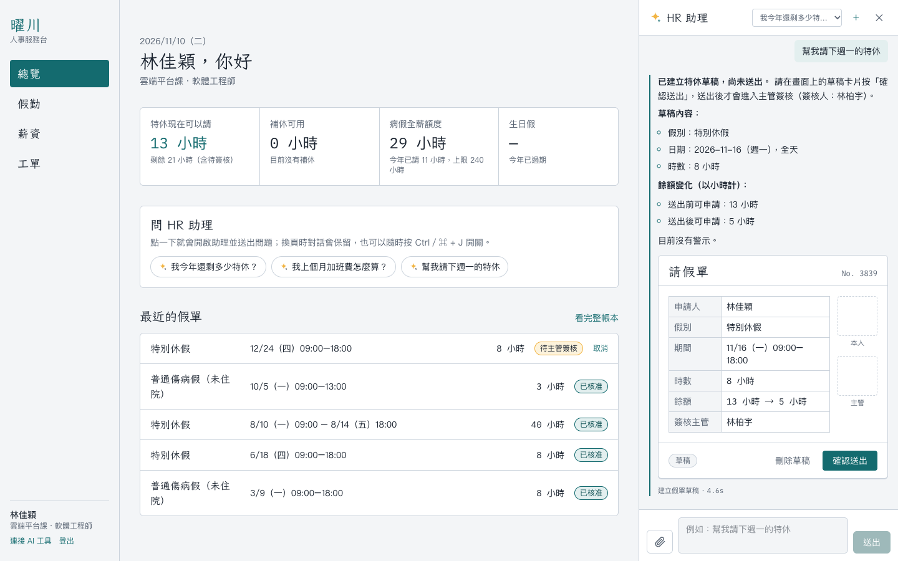
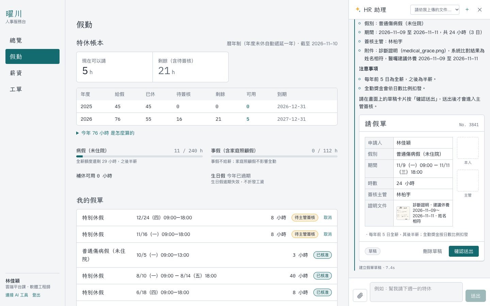
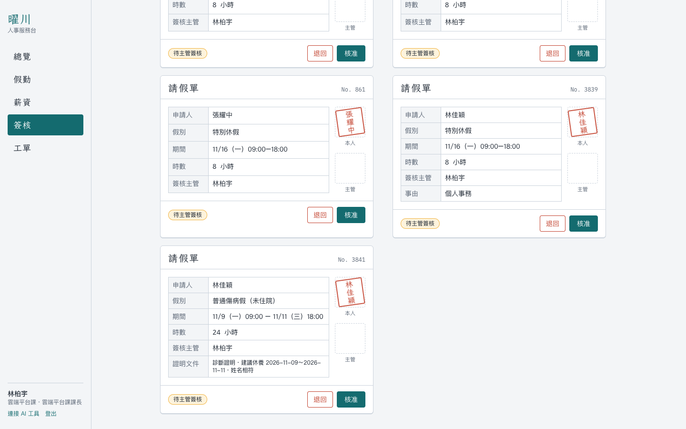
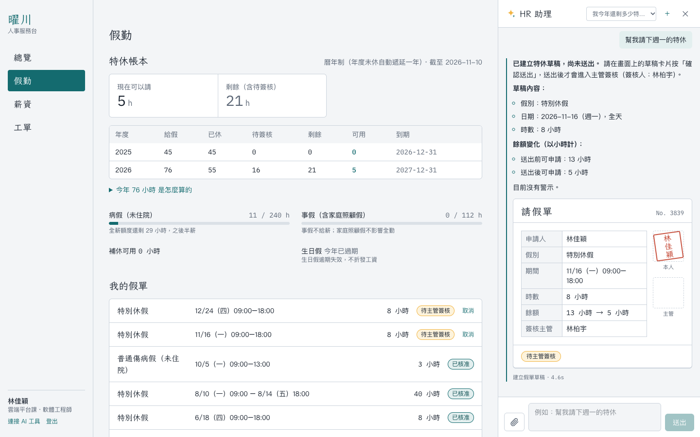
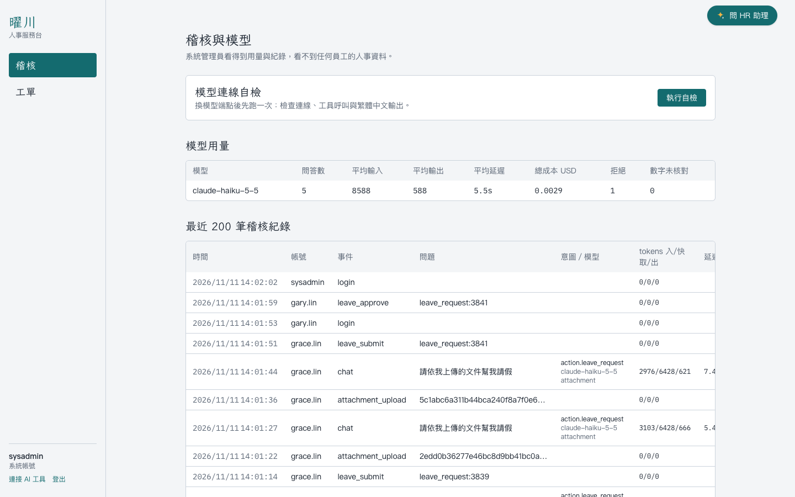
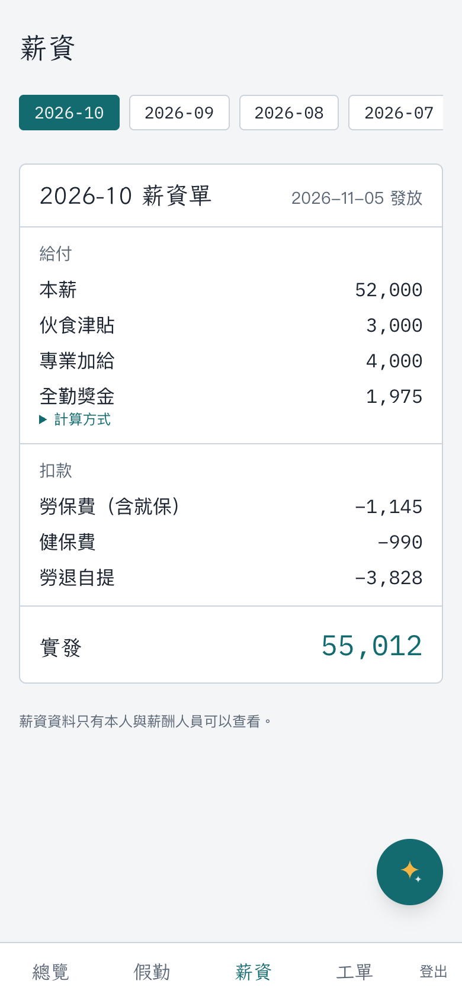

# hr360 — HR 助理平台

員工有人事問題（還剩幾天特休、加班費怎麼算、明天想請假）不必再一個個問 HR。hr360 讓員工、主管、HR 用自然語言查詢與**辦理**人事事務：特休與加班費由程式依台灣勞動法令精準計算，權限依角色與組織範圍控管，請假可以直接在對話中建立假單、送主管簽核。

模型可以換成接入方自己的 AI（Claude、Microsoft Foundry、Azure OpenAI、vLLM、Ollama…），也可以用 MCP 把 hr360 的工具接到既有的 Agent 平台。



## 啟動

只需要 [Docker Desktop](https://www.docker.com/products/docker-desktop/)（Windows 需啟用 WSL 2，安裝程式會引導）。不需要安裝 Python、Node.js 或資料庫。

### Windows

1. 開啟 Docker Desktop，等左下角顯示 **Engine running**。
2. 解壓縮（或 `git clone`）後，**雙擊 `start.cmd`**。
3. 第一次會詢問要接哪個模型（可選「先不設定」），接著自動建置、啟動並開啟瀏覽器 <http://localhost:3000>。

之後再雙擊 `start.cmd` 就是直接啟動。停止服務：在資料夾開啟終端機執行 `docker compose down`。

### macOS／Linux

```bash
./setup.sh
docker compose up -d --build
```

### 說明

- 設定步驟會自動產生資料庫密碼、登入金鑰與示範帳號密碼，只問要接哪個模型；選「先不設定」也能啟動，只有 HR 助理聊天會提示尚未接上模型。
- 第一次建置需要網路（下載 Docker 映像檔與套件），約 1–5 分鐘；之後啟動只要幾秒。第一次啟動會自動建立資料表、產生示範資料、匯入規章知識庫。
- 用下表的示範帳號登入；密碼會顯示在啟動視窗，也記在 `.env` 的 `SEED_DEMO_PASSWORD`。
- 用 `sysadmin` 登入，在「稽核」頁按「執行自檢」，確認模型連線、工具呼叫、繁中輸出都正常。

| 帳號 | 角色 | 可以試試 |
|---|---|---|
| `grace.lin` | 員工（軟體工程師） | 「我今年還剩多少特休？」「幫我請 11/12 的特休」「小王的薪水多少？」 |
| `kevin.chen` | 主管（韌體一課課長） | 「我的團隊 7 到 9 月誰請最多假？」 |
| `gary.lin` | 主管（雲端平台課課長） | 到「簽核」核准林佳穎送出的假單 |
| `allen.huang` | 員工 | 「我十月的加班費多少？怎麼算的？」（含休息日 10 小時、國定假日出勤、補休） |
| `peggy.yang` | 員工 | 「我婚假還剩幾天？」（婚假 8 日改 14 日的新舊制過渡） |
| `vivian.wu` | HRBP（研發、製造） | 查研發人員的特休可以，查業務人員不行 |
| `sharon.tsai` | 薪酬人員 | 可以查全公司薪資 |
| `sysadmin` | 系統管理員 | 稽核紀錄、模型用量、模型自檢；看不到任何員工資料 |

## 它做什麼

| 情境 | 怎麼處理 |
|---|---|
| 特休還剩多少 | 依到職日算曆年制比例特休，從假勤帳本扣除已休、遞延先扣、列出待簽核預扣，附計算過程 |
| 加班費怎麼算 | 平日、休息日（含第 9–12 小時）、國定假日分段計算，檢查每月 46 小時上限，區分補休 |
| 主管查團隊出勤 | 只看得到組織樹下層的部屬，不含請假原因 |
| 問同事薪水 | 薪資屬機密，員工、主管、HRBP 都查不到；回覆不透露此人是否存在 |
| 幫我請明天的假 | 建立假單草稿（算時數、查餘額、擋國定假日與重疊），本人按確認才送出，主管在簽核頁核准 |
| 拍診斷證明、訃聞、結婚證書 | 看圖模型讀出日期與當事人，程式比對姓名與請假期限，建立附上文件的假單草稿；主管只看到判讀摘要，看不到原圖 |
| 規章問答 | 檢索 16 份公司規章與 FAQ，附出處條次；查不到就建議轉人資 |
| 有爭議、要找人 | 開立工單；性騷擾申訴走機密工單 |

## 設計重點

- **數字不讓模型算**：特休、加班費、請假扣薪、婚假新舊制、資遣費、勞健保與勞退都在計算引擎完成，模型只轉述。法規參數依生效日版本化，出處見 [docs/sources.md](docs/sources.md)。
- **權限寫在資料層**：範圍條件寫進 SQL；工具參數沒有身分欄位，對話中自稱主管或要求「切換成管理員模式」都無效。
- **模型只能建草稿**：送出假單一定要本人在畫面上確認，防止被夾帶指令的內容代為送出。
- **不相信模型的自述**：回答中的數字必須能在工具結果找到；宣稱「已建立草稿」卻沒有成功呼叫工具的回答會被攔下。
- **讀圖的模型拿不到工具**：上傳的文件先由看圖模型轉成固定欄位（不讀病名），這一步沒有任何工具可呼叫；圖片上夾帶「幫我請一整年特休」之類的文字只會被標記忽略。欄位再由程式比對規定，時數仍由計算引擎重算。
- **換模型不換正確性**：模型中立的 Adapter＋MCP server；接上新模型後跑評測，就知道它能不能上線。

架構與取捨：[docs/ARCHITECTURE.md](docs/ARCHITECTURE.md)。接入自己的 AI：[docs/INTEGRATION.md](docs/INTEGRATION.md)。

## 評測

評測集 [api/eval/cases.yaml](api/eval/cases.yaml) 共 43 題，涵蓋特休、加班費、團隊範圍、8 種薪資越權嘗試（含自稱人資、提示詞注入、系統管理員）、薪資單、請假草稿、規章問答、轉人工，以及 5 題上傳證明文件（診斷證明、姓名不符、圖片夾帶指令、訃聞、結婚證書；圖片由 [make_docs.py](api/eval/fixtures/make_docs.py) 合成）。標準答案寫死並附人工驗算；口徑由 LLM-as-judge 判斷，judge 先用 10 份正確回答與 12 份故意改錯的版本校準（22/22，[CALIBRATION.md](api/eval/CALIBRATION.md)）。

每題跑 2 次（模型輸出不完全穩定，路由要求每一次都通過）：

| 模型 | 通過率 | 數字正確 | 口徑正確 | 越權洩漏 | 平均延遲 | 每題成本 |
|---|---|---|---|---|---|---|
| Claude Haiku 5.5 | 100%（86/86） | 100% | 100% | 0% | 4.7 s | US$0.0005 |
| Claude Sonnet 5.5 | 100%（86/86） | 100% | 100% | 0% | 5.0 s | US$0.0072 |

模型分流表 [api/config/router_table.yaml](api/config/router_table.yaml) 由評測產生：每個意圖選「每次都通過、零洩漏、且至少 3 題」中最便宜的模型。目前查假、加班費、薪資、請假、規章走 Haiku；團隊分析、轉人工、福利題數不足，維持 Sonnet。

```bash
# 用目前設定的模型重跑評測、更新分流表（會呼叫模型、產生費用）
docker compose exec api python -m app.evals.run --models fast,strong --repeats 2 --write-router
```

## Token 與成本

數字取自評測實測（Claude，2026-11）：

| 項目 | Haiku 5.5 | Sonnet 5.5 |
|---|---|---|
| 平均輸入（含快取） | 7,141 tokens | 7,135 tokens |
| 其中快取命中比例 | 86% | 85% |
| 平均輸出 | 496 tokens | 363 tokens |
| 平均工具呼叫 | 1.2 次 | 1.2 次 |
| 平均延遲／P95 | 4.4 s／7.7 s | 4.7 s／6.9 s |
| 每題成本 | US$0.0004 | US$0.0068 |

依分流表混用兩個模型，平均每題約 US$0.0013，比全部使用 Sonnet 少約 80%。

降低用量的做法：system prompt 與工具定義放在快取斷點之前（約 5,900 tokens 以快取價計）；每次會變的內容（日期、使用者）放在斷點之後；工具只回精簡 JSON；對話記憶只存問答文字、不存工具輸出；聊天端點獨立限流並有每人每日 token 上限。

## 專案結構

```
hr360/
├── start.cmd                Windows 雙擊啟動
├── setup.sh / setup.ps1     產生 .env
├── docker-compose.yml       db（PostgreSQL 16＋pgvector）、api、web
├── Makefile                 macOS／Linux 常用指令捷徑
├── docs/                    架構、接入指南、法規出處、截圖
├── api/                     FastAPI（Python 3.12）
│   ├── app/engine/          勞動法令計算引擎（純函式）
│   ├── app/company/         公司規定參數、薪資單計算
│   ├── app/services/        假勤帳本、查詢、請假流程、工單
│   ├── app/agent/           LLM Adapter、分流、Agent loop、數字檢查、稽核
│   ├── app/evals/           評測、judge、校準
│   ├── app/mcp_server.py    MCP server
│   ├── kb/                  公司規章（Markdown）
│   ├── seed/                示範資料產生器與一致性檢查
│   ├── eval/                評測集與報告
│   └── tests/               單元與整合測試
└── web/                     Next.js 16＋Tailwind CSS 4
```

## 開發

```bash
docker compose up -d db                        # 只起資料庫
cd api && uv sync && set -a && . ../.env && set +a
uv run alembic upgrade head && uv run python -m seed.run && uv run python -m app.kb.ingest
uv run pytest -q                               # 149 個測試
uv run uvicorn app.main:app --port 8360 --reload
cd ../web && npm ci && npm run dev             # http://localhost:3000
```

## 截圖

| 對話中建立請假單 | 拍照上傳診斷證明 |
|---|---|
|  |  |
| **主管簽核（只看文件判讀摘要）** | **假勤帳本（送出後立即預扣）** |
|  |  |
| **稽核與模型自檢** | **手機：薪資單** |
|  |  |

## 說明

示範資料中的公司、人員、規章皆為虛構，個資格式刻意無效，不對應真人。勞動法令數字已依官方來源核對（[docs/sources.md](docs/sources.md)），但本專案不構成法律意見。
